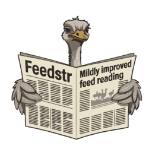

# Feedstr

**Mildly improved reading.**

A feed reader, written in Rust, that syncs your feeds and other content over the decentralized
Nostr protocol.

[Usage guide](usage/) · [Source code on GitHub](https://github.com/0n4t3/feedstr)

> **⚠️ Warning:** Feedstr is completely vibe coded and, for now, barely
> tested. **I do not recommend using it at this time** unless you just want to
> test it. I intend to use it myself for a while. After a few months of daily
> driving, if it's working well and I intend to support it long term, I'll
> update this warning.

## Why Feedstr?

Feedstr was born out of a very personal annoyance: I wanted private RSS feed
sync, but didn't want to host my own FreshRSS instance (it would be the only
publicly accessible service on my home server right now).

Feedstr attempts to solve that by syncing feeds, read/unread status and
favorites over the decentralized Nostr protocol. It relies on either
community relays (the default) or a multi-purpose self-hosted relay.

## RSS++
In addition to standard RSS/ATOM feeds, Feedstr supports following additional content:
- **Nostr NIP-23 Blog Posts**, of all users you follow
- **YouTube channels**, which can be added by pasting a YouTube channel link, which can serve either all content or only standard videos (filtering out shorts & livestreams)
- Blogs on **Tor & I2P**, using your local Tor/I2P router as a proxy
- **Gemini Capsules**, which can be followed like standard HTTP websites
- **Websites on Nostr (nsites)**, whose pages show up as articles, or that site's own feed if it has one

## Features
- **Zero tracking:** no outgoing connections ever, aside from fetching feeds
  and syncing
- **End-to-end encrypted sync:** no need to trust a community relay
- **Linux (Flatpak), Android and web** support
- **A lightweight, multi-purpose server:** a Nostr relay can do quite a bit
  more than just sync feeds
- **OPML** import and export
- **Sandboxing:** bare-bones permissions for the Flatpak and Android
  versions, and total sandboxing in the web version
- **Local Only categories:** Fine tune what's actually synced

## Potential Future Features
- Windows builds
- PWA support
- Social bookmarking and quotes (optional)
- Fetching links and bookmarks from ActivityPub, AT Protocol and Nostr users
- A tool to import and export full feed data (read status, favorites, etc.)
  from FreshRSS and other readers
- A page archive tool
- Text To Speech reading
- Feed subgroups
